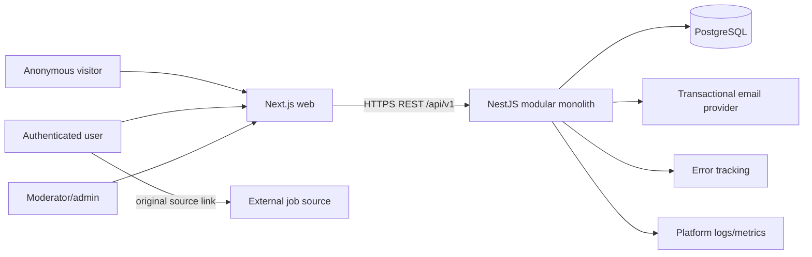
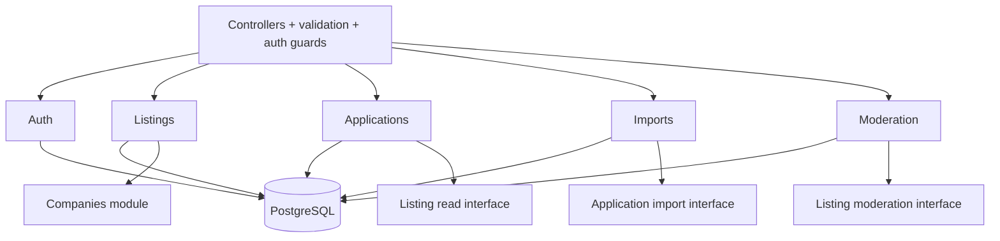

# Executive architecture summary

## Recommendation

Build Orbit as a **modular monolith** in a **pnpm workspace monorepo**:

- `apps/web`: Next.js App Router, React, strict TypeScript, Tailwind CSS using semantic CSS variables.
- `apps/api`: NestJS REST API, cohesive business modules, OpenAPI, background work hosted from the same codebase as a separately runnable process only when required.
- `packages/contracts`: transport-safe request/response schemas and generated/client types; never Prisma models.
- PostgreSQL is the system of record. Prisma handles the common persistence path; reviewed SQL migrations implement constraints/indexes Prisma cannot express well.
- Opaque, hashed, revocable session tokens in secure cookies; session records in PostgreSQL.

This gives independent deployment boundaries without multiplying runtime systems. Modules are boundaries for reasoning and tests, not miniature services pretending to be distributed.

## System context



External job sources are navigated by the user. The MVP API does **not** fetch arbitrary submitted URLs, preventing an SSRF/crawler problem.

## Backend components and ownership



Modules own writes to their tables. Cross-module behavior calls an exported application service within one transaction where synchronous consistency matters. No module imports another module’s repository or Prisma delegate directly.

## Consistency boundaries

- Saving a listing creates an application and its initial stage event atomically.
- Moving a stage updates the application version/current stage and appends history atomically.
- Moderator action updates listing/report state and appends audit atomically.
- Import commits bounded row chunks and durable per-row results; batches may be partially successful but never ambiguous.
- Email sending happens after durable token creation; a failed email is retryable and does not roll back account creation.

## Frontend architecture

- Route groups express public, authenticated, and moderation shells.
- `features/*` own workflow components, queries, forms, and feature-local tests.
- `components/ui` contains accessible primitives with no product rules.
- A single API client handles base URL, credentials, correlation IDs, validation errors, and `401` behavior.
- Server state uses TanStack Query where interactive caching/mutations matter; URL search params own public-feed filter state. Avoid a global client store until a real cross-feature state problem appears.
- Server Components may fetch public data, but private data must never enter shared/static caches.

## Theme architecture

Use Tailwind utilities backed by semantic CSS custom properties:

```css
:root { --surface-canvas: ...; --text-primary: ...; --action-primary: ...; }
[data-theme='dark'] { --surface-canvas: ...; --text-primary: ...; --action-primary: ...; }
```

Tokens cover canvas/surface/elevated backgrounds, primary/secondary/muted text, borders, action states, success/warning/danger, focus ring, shadows, typography, spacing, radius, and motion. Components reference roles such as `bg-surface-card`, never `dark:bg-[#...]`.

Theme resolution runs before paint from a tiny CSP-compatible script: explicit cookie/local preference → system preference → light fallback. The server reads the cookie when possible. A third theme adds one token block plus contrast/visual regression tests; feature components should not change.

## Future extraction reality

Likely candidates are email/notifications, imports, and ingestion—not core applications. Extraction still requires independent data ownership, backfill/dual-write strategy, service identity, network contracts, retries/idempotency, traces, deployments, and an eventual-consistency UX. Module boundaries reduce coupling; they do not make extraction free.
