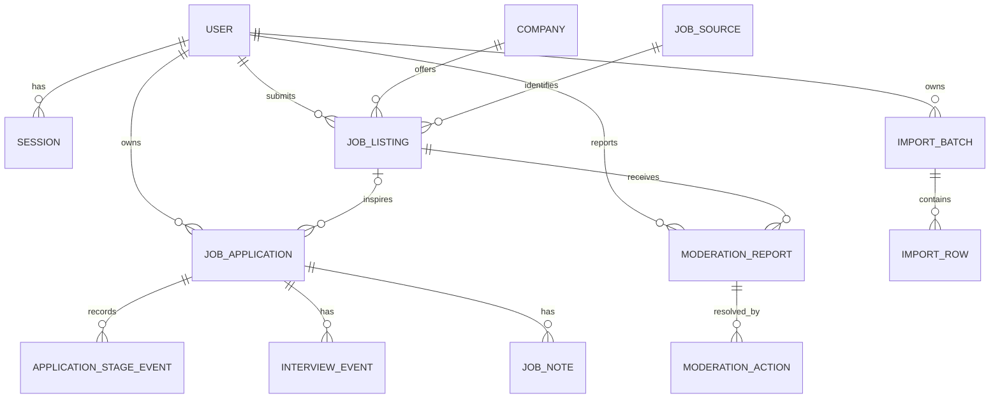

# Domain model and data integrity

## Critical distinction

`JobListing` is public, community-curated discovery data. `JobApplication` is private user-owned career data. Saving a listing creates an application containing a snapshot of relevant listing fields plus an optional link to the listing. Deleting/hiding/editing the public listing must not corrupt the private history.

## Entities, ownership, and constraints

| Entity | Owner | Key integrity rules |
|---|---|---|
| `User` | identity | case-insensitive normalized email unique; role enum; status; verified timestamp |
| `Session` | identity/user | store SHA-256 token digest only; expiry/revocation; indexed by user and expiry |
| `Company` | companies | canonical name; optional normalized website domain; mergeable, not “verified” by default |
| `JobSource` | listings | source type, canonical origin/domain; no secrets |
| `JobListing` | listings | submitter/company/source FKs; status; canonical URL hash; published/expiry timestamps; version |
| `JobApplication` | applications/user | owner FK; optional listing FK; immutable listing snapshot; stage; version; timestamps |
| `ApplicationStageEvent` | applications/user | append-only from/to stage, occurred time; same owner inferred through application |
| `InterviewEvent` | applications/user | application FK; round type, scheduled time, status/outcome; no orphan |
| `JobNote` | applications/user | application FK; plain text, bounded length; created/updated time |
| `ImportBatch` | imports/user | owner, file digest, mapping/version, state, counts; idempotency key unique per owner |
| `ImportRow` | imports/user | batch + row number unique; normalized payload, error list, resulting application FK |
| `ModerationReport` | moderation | reporter/listing; category/reason/status; dedupe active report per reporter/listing/category |
| `ModerationAction` | moderation | append-only actor/action/reason/before-after metadata; indexed target/time |

## Indexes for actual query paths

- Public feed: `(status, published_at DESC, id DESC)`; filtered indexes for active rows; company/location/work-mode indexes after `EXPLAIN` evidence.
- Search: PostgreSQL full-text `tsvector` over title/company/location; `pg_trgm` only if typo-tolerance is approved and supported.
- Private history: `(user_id, updated_at DESC, id DESC)`, `(user_id, stage, updated_at DESC)`, `(user_id, applied_at DESC)`.
- Moderation queue: `(status, created_at, id)` and `(job_listing_id, status)`.
- Import recovery: `(user_id, created_at DESC)` and unique `(batch_id, row_number)`.
- Session cleanup: `(expires_at)`; active sessions `(user_id, revoked_at)`.

Do not index every filter pre-emptively; measure query plans and write amplification.

## PostgreSQL enforcement

- Foreign keys with deliberate delete behavior; private child rows cascade with account/application deletion, audit records restrict or anonymize.
- Check constraints for non-empty bounded strings, valid date relationships, non-negative counts, and legal enum/state values where stable.
- Unique constraints for normalized email, session digest, idempotency keys, and canonical listing URL hash where policy permits.
- Application version supports optimistic concurrency; the service updates `WHERE id = ? AND user_id = ? AND version = ?`.
- Every private query includes `user_id`; repository APIs require owner ID. API isolation tests are mandatory. PostgreSQL row-level security is reconsidered if ad-hoc data access or multi-tenant analytics expands.

## Duplicate detection

1. Canonicalize URL: allow only `https`; lowercase host; IDNA normalize; remove fragments/default ports; normalize path; remove known tracking parameters; sort retained query parameters.
2. Exact canonical URL hash is high-confidence duplicate.
3. MVP warning score: normalized company + title + location + source + recent publication window.
4. A contributor may override a warning with a reason; moderators can merge aliases while preserving application references.
5. Never fetch arbitrary source URLs in MVP. Redirect resolution or page fingerprints are future ingestion work with SSRF defenses.

## Deletion, expiry, and retention

- Listings use lifecycle states rather than physical deletion so private references and moderation history survive. Default expiry is an **open policy decision**.
- Private notes/applications should hard-delete after a short recoverability window if deletion semantics and backups permit; document backup aging in the privacy policy.
- Public contributions may be anonymized on account deletion if legitimate retention is approved.
- Raw import content is retained only long enough for retry/debugging (proposed: 24 hours); row diagnostics/batch metadata proposed for 30 days; resulting applications follow user retention.
- Moderation audit is append-only and retained longer (proposed: 1 year), with minimized personal data.

## Import transaction and recovery model

- Parse into validated rows without mutating applications; mapping schema is versioned.
- Confirmation acquires the batch state transition (`PREVIEWED → PROCESSING`) atomically.
- Commit small chunks (for example, 100 rows). Each row has a deterministic fingerprint and result state.
- A retry skips committed fingerprints and resumes pending rows. Batch counts derive from rows, avoiding invented progress.
- `COMPLETED_WITH_ERRORS` is a valid terminal state. Whole-file atomicity is intentionally rejected because one bad row should not lose thousands of valid rows.
